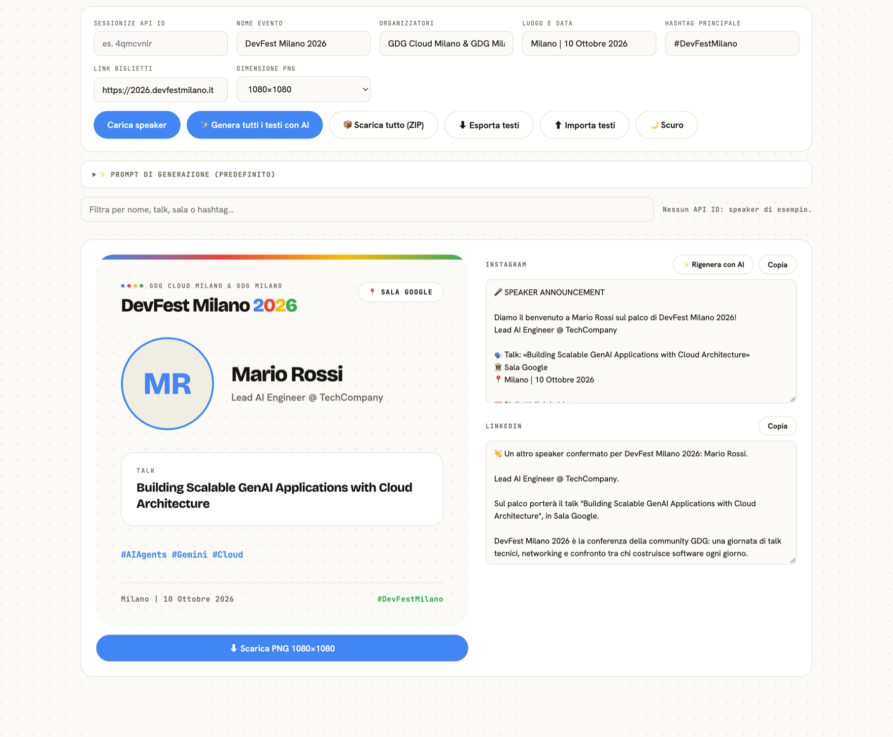

# DevFest posts generator

Prende gli speaker confermati da Sessionize e per ognuno genera la locandina
(PNG quadrato) piu' il testo del post per Instagram e LinkedIn, con o senza AI.



## Avvio

```bash
docker compose up --build   # http://localhost:8090
```

Sviluppo con hot reload, un comando solo:

```bash
npm run dev      # http://localhost:5173
```

Avvia Vite (hot reload della UI, React Fast Refresh) e il server Node in
`--watch` sulla 8091, che si riavvia da solo quando salvi `server.mjs`. Vite gli
gira `/api`, `/img`, `/genera` e `/stato`. Con `PORT=...` cambi la porta del
backend; la 8080 di default in Docker in locale e' spesso gia' occupata.

**Docker non ha hot reload**: serve la build di `dist/`, quindi ogni modifica
richiede `docker compose up --build`. Usalo per provare il risultato finale,
non per sviluppare.

## Uso

1. Incolla l'**API ID** di Sessionize, compila i campi dell'evento, premi
   **Carica speaker**. Resta nel localStorage. In alternativa apri
   `http://localhost:8090/?api=<API_ID>`.
2. Le locandine escono in tre formati: **Instagram** e **Facebook** 1080×1350
   (4:5, verticale), **LinkedIn** 1200×1200 (1:1). Ogni speaker ha un pulsante
   per formato; lo ZIP ha una cartella per piattaforma. **Anteprima** sceglie
   quale proporzione vedere in pagina, il download non ne dipende. Il formato
   finisce nel nome del file (`...-instagram-1080x1350.png`).
3. **📦 Tutte le locandine + testi**: le locandine visibili nei tre formati piu'
   `testi-post.doc` con i testi di ogni speaker, Instagram e LinkedIn.
4. **⬇︎ Esporta testi** salva un JSON con configurazione, testi dei due post e
   modifiche fatte a mano sulle locandine. **⬆︎ Importa testi** lo ricarica: utile
   per riprendere il lavoro, passarlo a qualcuno o rivedere i testi altrove.
   L'abbinamento usa l'id Sessionize e, se non combacia, il nome dello speaker.
5. **🌙 Scuro / ☀️ Chiaro** cambia tema; la versione scura esce col suffisso `-dark`.
6. **✨ Rigenera con AI** riscrive i due post per uno speaker, **✨ Genera tutti**
   li rifa per tutti (tre alla volta). Serve la configurazione qui sotto.
7. Senza API ID vedi uno speaker di esempio, utile per provare il layout.
8. Ogni sezione ha il suo indirizzo: `/carte`, `/organizzatori-sponsor`, `/speaker`, `/kit-social-speaker/carta`,
   `/kit-social-speaker/foto` e `/kit-social-sponsors`. Si possono condividere e avanti/indietro del
   browser funzionano; `?api=` resta attaccato quando cambi tab.

Ogni campo della locandina e' **modificabile cliccandoci sopra**. I segnaposto
dei campi vuoti non finiscono nel PNG.

## Kit social speaker

Il tab **🃏 Kit social speaker** prende la carta BizzyMagic di ogni speaker e prepara
storia (1080×1920), post (1080×1350), carosello di 4 slide (1080×1350), reel in
stop motion da 12 secondi (la carta arriva coperta e si gira) e caption.

1. Le carte stanno in una cartella di PNG chiamati `NN.Nome_Cognome (...).png`.
   `node scripts/carte.mjs "<cartella>"` le abbina agli speaker e scrive
   `public/carte/speaker.json` piu' le carte in JPG. Gli speaker e i talk li
   legge dall'agenda di 2026.devfestmilano.it, che e' sincronizzata con Sessionize.
   Nickname e nomi scritti diversamente sulla carta stanno in `ALIAS` e
   `SULLA_CARTA` dentro lo script.
2. Il riquadro **Scarica il kit completo** raccoglie i download in blocco.
   **⬇︎ Tutto il kit** fa un solo ZIP con immagini, caption e reel di ogni
   speaker nella sua cartella, piu' i reel delle altre carte in `altre-carte/`.
   Registra tutti i reel in tempo reale, quindi ci mette quanto le voci sotto
   messe insieme. **📦 Immagini + caption** scarica solo le immagini, una
   cartella per speaker.
3. **🎬 Reel degli speaker** li registra uno dopo l'altro in tempo reale (circa 5 minuti
   per 23 speaker): tieni la scheda in primo piano.
4. **🃏 Reel delle altre carte**: un reel con caption per ogni carta che non e' di
   uno speaker (evento, partner, location, team, collezione), scritte dallo script
   in `public/carte/altre.json`. Il gruppo, che decide sottotitolo e caption, sta in
   `GRUPPI` dentro lo script; le carte della sottocartella delle aggiunte non hanno
   il numero in sovraimpressione, perche' hanno una numerazione loro.

Chrome blocca il secondo download automatico dalla stessa pagina finche' non lo
autorizzi: se il secondo ZIP non arriva, controlla l'icona nella barra degli indirizzi.

### Carica carte (senza script)

La sezione **📤 Carica carte** (`/carte`, primo tab) fa lo stesso lavoro dello script
dal browser: trascini le immagini delle carte (o le scegli dal disco) e ognuna si
collega da sola allo speaker Sessionize con lo stesso nome, letto dal file come fa
lo script (`NN.Nome_Cognome (...).png`). Le altre le colleghi a mano: trascini la
carta sullo speaker, oppure clicchi la carta e poi lo speaker. Un filo verde segna
le coppie fatte. Per scollegarne una usi la ✕ o la riporti tra le carte libere.
Sotto gli speaker ci sono le righe di **🧑‍💻 Organizzatori** e **🤝 Sponsor**, presi
dall'anagrafica (vedi sotto), e si abbinano allo stesso modo.
Finche' ci sono carte caricate, i kit usano quelle al posto di `public/carte/`:
**🃏 Con la carta** esce per gli speaker collegati, e organizzatori, sponsor e carte
libere diventano le "altre carte" (sottotitolo e caption dal loro gruppo; per le
libere decide il nome, `GRUPPI` in `src/carte.js`). Il kit organizzatori prende la
carta abbinata qui.

### Organizzatori e sponsor

La sezione **👥 Organizzatori e sponsor** (`/organizzatori-sponsor`) e' l'anagrafica:
per gli organizzatori nome, ruolo (il GDG), lavoro e foto, per gli sponsor nome e
sottotitolo. Si aggiunge, si modifica e si toglie dalla pagina. Finche' non la tocchi
viene da `public/carte/team.json` e dai partner di `src/reel.js`; alla prima modifica
resta nel localStorage (foto comprese, ridotte a 600 px) e **↺ Ripristina** torna ai
dati di partenza. La usano Carica carte e il kit organizzatori; il kit sponsors resta
su `PARTNER` in `src/reel.js`, perche' logo, immagini e colori non stanno in un form.
Le immagini restano solo nella scheda; gli abbinamenti fatti a mano stanno nel
localStorage per nome di file, quindi ricaricando la stessa cartella tornano al loro posto.

### Kit da Sessionize (senza carta)

Nello stesso tab, **📸 Da Sessionize (foto)** fa storia, post, carosello, reel e
caption per ogni speaker partendo solo da Sessionize: la foto profilo diventa una
polaroid che nel reel si sviluppa a scatti, e il carosello ha una slide con la bio.
Usa gli speaker caricati con l'API ID in alto (default `qcrth74k`), quindi esce
per tutti, anche per chi non ha la carta. Le foto Sessionize sono 400×400: in
pagina restano sotto i 620 px di lato.

## Kit social sponsors

Il tab **🤝 Kit social sponsors** (`/kit-social-sponsors`) mostra gli sponsor uno
sotto l'altro, come gli speaker, e per ognuno disegna un reel verticale 1080×1920
in stop motion: 16 secondi a 12 pose al secondo, pezzi di carta che entrano a
scatti e tremano come spostati a mano. Quattro scene: nome dell'evento a lettere
ritagliate, logo del partner col simbolo che si muove (la mano di BizzyNow saluta,
l'onda di Datwave dondola), un telefono con le schermate dell'app o una polaroid
con le immagini del partner accanto a tre post-it, invito finale.

- Ogni scheda ha anteprima, testi del reel e caption modificabili.
- **⬇︎ Tutto il kit** fa un ZIP con reel e caption di ogni sponsor, una cartella
  per sponsor; **🎬 Reel** sotto l'anteprima scarica solo quello sponsor. I video si
  registrano dal canvas con `MediaRecorder` in tempo reale (MP4 su Chrome e
  Safari recenti, altrimenti WebM): tieni la scheda in primo piano.
- Il video e' muto: la musica si aggiunge su Instagram.
- **Aggiungere un partner**: una voce in `PARTNER` (`src/reel.js`) con logo SVG,
  riquadro del simbolo, tre immagini, colori, testi e caption; gli asset in
  `public/partner/<id>/`.
- Loghi, schermate e badge in `public/partner/` vengono dai siti dei partner
  (bizzynow.com, datwave.ai).

## Kit social organizzatori

Il tab **🙌 Kit social organizzatori** (`/kit-social-organizzatori/carta` e `/foto`)
fa per ogni persona del team storia, post, carosello di 4 slide, reel e caption,
con la carta BizzyMagic o con la foto della pagina team del sito. Le persone
vengono dall'anagrafica **👥 Organizzatori e sponsor**; la carta e' quella abbinata
in Carica carte o, se manca, quella di `team.json`.

`node scripts/team.mjs` legge nome, GDG e lavoro da 2026.devfestmilano.it/it/team/,
scarica le foto in `public/carte/team-*.jpg` e abbina le carte per nome da
`public/carte/altre.json`; scrive `public/carte/team.json`. I testi non dicono
"ci vediamo sabato" e non rimandano ai biglietti, cosi' il kit va bene anche
dopo l'evento.

## Cosa arriva dai dati e cosa no

| Campo locandina | Origine |
|---|---|
| Nome, ruolo, foto | speaker Sessionize (tagline tagliata al primo `\|`) |
| Titolo | sessione confermata |
| Talk o Workshop | dedotto da sala e durata: Sessionize non lo marca |
| Sala | `rooms[]` + `session.roomId`, cioe' la schedule pubblicata |
| Hashtag argomento | dedotti da titolo + abstract (`TOPIC_TAGS` in `src/sessionize.js`) |

Vengono restituiti solo gli speaker pubblicati, e l'app scarta le sessioni con
`isConfirmed: false`: in lista restano solo i confermati.

## AI

Facoltativa. Senza configurazione i post escono da template e i pulsanti AI
spariscono. Copia `.env.example` in `.env` e riempi:

```
AI_ENDPOINT=...   # Gemini o Azure AI Foundry, vedi .env.example
AI_API_KEY=...
AI_MODEL=...
```

Vanno bene anche i nomi `AZURE_AI_FOUNDRY_*`. L'endpoint puo' essere l'URL
completo di `chat/completions` o solo quello base della risorsa Azure.

La chiave sta **solo sul server**: il browser chiama `/genera`, mai il provider.
Al modello passano nome e cognome, ruolo, bio, tipo di sessione, titolo,
abstract completo, sala e argomenti — non solo il titolo.

Il **prompt e' modificabile dall'interfaccia** (pannello "Prompt di generazione"),
resta nel localStorage e si ripristina con un pulsante.

## Struttura

- `src/` — UI React (Vite). `sessionize.js` mapping dei dati, `posts.js` template
  e chiamata a `/genera`, `export.js` PNG/ZIP/Word, `Card.jsx` la locandina.
- `server.mjs` — un solo processo Node senza dipendenze: serve `dist/`, fa da
  proxy verso Sessionize e parla col provider AI.
- `test.mjs` — `npm test`, copre il mapping del payload Sessionize.

Il proxy non e' decorativo: le foto devono arrivare same-origin, altrimenti
html2canvas sporca il canvas e l'export PNG fallisce.

## Tema

Ripreso da <https://2026.devfestmilano.it>: token chiari e scuri (`#fbfaf6`/`#0f0e0c`
fondo, `#17150f`/`#f4f1e9` testo, i quattro colori GDG), sfondo a puntini,
micro-label in mono, chip col bordo sottile. Font Bricolage Grotesque, Hanken
Grotesk e JetBrains Mono.

Nota: il pattern a puntini e' un SVG inline e non un `radial-gradient` perche'
html2canvas i gradient radiali non li disegna, e sparirebbe dal PNG.
